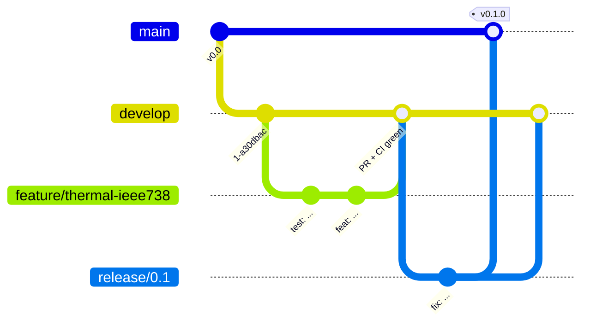

# PyPowerlines developer guide

Everything you need to work on PyPowerlines day to day: setting up with **uv**, the commands
for testing and checking code, managing dependencies, and the **git branch workflow** on GitHub.

This is the practical companion to *PPL-DEV-001 Development Environment and Setup Guide* in
`Claude outputs/`. Where they differ, the repository (`pyproject.toml`, `.pre-commit-config.yaml`,
`.github/workflows/ci.yml`) is the source of truth.

> Commands are shown for **Windows (PowerShell)**. They are the same on macOS/Linux unless noted.
> Run every command from the **project root** (the folder containing `pyproject.toml`).

---

## Contents

1. [What is uv?](#1-what-is-uv)
2. [First-time setup](#2-first-time-setup)
3. [Everyday commands](#3-everyday-commands)
4. [Testing in detail](#4-testing-in-detail)
5. [Code quality checks](#5-code-quality-checks)
6. [Managing dependencies](#6-managing-dependencies)
7. [Python versions](#7-python-versions)
8. [Branches and the git workflow](#8-branches-and-the-git-workflow)
9. [Commit messages](#9-commit-messages)
10. [Releases and version numbers](#10-releases-and-version-numbers)
11. [Continuous integration (GitHub Actions)](#11-continuous-integration-github-actions)
12. [Troubleshooting](#12-troubleshooting)
13. [Cheat sheet](#13-cheat-sheet)

---

## 1. What is uv?

[uv](https://docs.astral.sh/uv/) is a single, very fast tool that replaces `pip`, `venv`,
`pip-tools` and `pyenv`. For this project it does four jobs:

| Job | Old way | uv way |
|---|---|---|
| Install the right Python | python.org installer / pyenv | `uv python install 3.14` |
| Create a virtual environment | `python -m venv .venv` | automatic (`.venv/`) |
| Install dependencies | `pip install -r requirements.txt` | `uv sync` |
| Pin exact versions | `pip freeze > requirements.txt` | automatic (`uv.lock`) |

### The four files uv cares about

| File | What it is | Edit it? | Commit it? |
|---|---|---|---|
| `pyproject.toml` | What the project *needs*: dependencies with minimum versions, tool settings | Yes (or via `uv add`) | Yes |
| `uv.lock` | The *exact* version of every package, for every OS. Makes installs reproducible | **Never by hand**. uv writes it | **Yes** |
| `.python-version` | The Python version for this project (`3.14`) | Via `uv python pin` | Yes |
| `.venv/` | The virtual environment: Python and installed packages | Never. It is disposable | **No** (ignored) |

### The one idea to remember: `uv run`

You don't need to "activate" the virtual environment. Put `uv run` in front of any command, and
uv first checks that `.venv` matches `uv.lock` (syncing it if not), then runs the command inside it:

```powershell
uv run pytest              # instead of: .venv\Scripts\activate; pytest
uv run python              # a Python shell with the project installed
uv run pypowerlines --help # the project's own command-line tool
```

If you prefer activating, it works too: `.venv\Scripts\activate` (Windows) or
`source .venv/bin/activate` (macOS/Linux). Type `deactivate` to leave.

---

## 2. First-time setup

Do this once per computer (or after a fresh clone).

### 2.1 Install the tools

```powershell
# uv (pick one)
winget install --id=astral-sh.uv -e
# or: powershell -ExecutionPolicy ByPass -c "irm https://astral.sh/uv/install.ps1 | iex"
# macOS: brew install uv

uv --version          # check it worked (open a new terminal if "not found")
uv self update        # update uv itself later on
```

You also need **git**. GitHub Desktop or the GitHub website is fine for pull requests.

### 2.2 Get the code and build the environment

```powershell
git clone https://github.com/MasonicTombomb/PyPowerlines.git
cd PyPowerlines
git switch develop              # day-to-day work starts from develop (see section 8)

uv sync --all-extras            # installs Python 3.14 if needed, creates .venv, installs everything
uv run pre-commit install       # turns on the automatic checks that run on every commit
```

`uv sync` installs, in one go:

- the **runtime dependencies** (`numpy`, `scipy`, `pandas`, `pydantic`, `pyyaml`, `annunciator`, ...);
- the **`dev` dependency group** (`pytest`, `ruff`, `mypy`, `sphinx`, ...), which is installed
  by default;
- with `--all-extras`, the **optional extras** `plots` (matplotlib) and `excel` (openpyxl).

### 2.3 Check everything works

```powershell
uv run pypowerlines --version   # prints e.g. "pypowerlines 0.1.dev4+g0eccfa5"
uv run pytest                   # all tests should pass, coverage >= 85 %
```

### 2.4 PyCharm

1. **Settings → Project → Python Interpreter → Add Interpreter → Add Local Interpreter →
   Select existing** → `.venv\Scripts\python.exe` (macOS/Linux: `.venv/bin/python`).
   Recent PyCharm versions also have a native **uv** interpreter type, which works too.
2. Right-click `src` → **Mark Directory as → Sources Root**; `tests` → **Test Sources Root**.
3. **Settings → Tools → Python Integrated Tools → Default test runner: pytest**.

---

## 3. Everyday commands

| Task | Command |
|---|---|
| Run the fast tests (what pre-commit runs) | `uv run pytest -m "not validation and not perf"` |
| Run **all** tests except benchmarks (what CI runs) | `uv run pytest -m "not perf"` |
| Run one test file | `uv run pytest tests/unit/test_units.py --no-cov` |
| Lint and auto-fix | `uv run ruff check --fix .` |
| Format code | `uv run ruff format .` |
| Type check | `uv run mypy src tests` |
| Check the architecture layers | `uv run lint-imports` |
| Run **every** commit check on every file | `uv run pre-commit run --all-files` |
| Build the documentation | `uv run sphinx-build -W -b html docs docs/_build/html` |
| Run the CLI | `uv run pypowerlines --help` |
| Python shell with the project loaded | `uv run python` |
| Add a dependency | `uv add <package>` (see [section 6](#6-managing-dependencies)) |
| Update the environment after a `git pull` | `uv sync --all-extras` |

Open the built docs at `docs/_build/html/index.html`.

---

## 4. Testing in detail

Tests live in `tests/` and use **pytest** and **hypothesis** (property-based tests). The
examples inside docstrings (`>>> ...`) also run as tests (`--doctest-modules`).

### 4.1 Test folders and markers

| Folder | Contents | Marker |
|---|---|---|
| `tests/unit/` | Fast tests, one file per module (`test_<module>.py`) | none |
| `tests/integration/` | Several modules working together | none |
| `tests/validation/` | Slow reference cases (IEEE 738, IEEE 14-bus, reference network) | `@pytest.mark.validation` |
| `tests/perf/` | QR-02 timing benchmarks | `@pytest.mark.perf` |
| `tests/data/` | Input fixtures and expected results | n/a |

Select tests by marker with `-m`:

```powershell
uv run pytest -m "not validation and not perf"   # fast set
uv run pytest -m validation                       # validation suite only
uv run pytest -m perf --no-cov -v                 # benchmarks only
```

### 4.2 Useful pytest options

| Option | Effect |
|---|---|
| `--no-cov` | Skip coverage. **Needed whenever you run only some tests**, see below |
| `-x` | Stop at the first failure |
| `-k thermal` | Run only tests whose name contains "thermal" |
| `--lf` | Re-run only the tests that failed last time |
| `-v` | List every test by name |
| `-q` | Quieter output |
| `--pdb` | Open the debugger at a failure |
| `--durations=10` | Show the 10 slowest tests |

```powershell
uv run pytest tests/unit/test_errors.py --no-cov -x
uv run pytest -k "input_error" --no-cov -v
uv run pytest tests/unit/test_cli.py::test_keyboard_interrupt_exits_130 --no-cov
```

> **Why `--no-cov`?** `pyproject.toml` makes pytest fail if total coverage is below **85 %**.
> Running one file covers only a fraction of the code, so the run "fails" even though every
> test passed. `--no-cov` turns coverage off for that run. The full run must still reach 85 %.

### 4.3 Coverage report

```powershell
uv run pytest --cov-report=term-missing   # shows which lines are not tested
uv run pytest --cov-report=html           # then open htmlcov/index.html
```

---

## 5. Code quality checks

Five automatic gates protect the code. They run **on every commit** (pre-commit, on your
machine) and **on every push / pull request** (GitHub Actions).

| Gate | Tool | What it checks | Fix it with |
|---|---|---|---|
| Lint | ruff | Bugs, style, naming, imports, NumPy-style docstrings | `uv run ruff check --fix .` |
| Format | ruff format | Consistent layout (line length 100) | `uv run ruff format .` |
| Types | mypy `--strict` | Type hints are complete and consistent | Fix the reported line |
| Layers | import-linter | Lower layers never import higher ones (`cli → io/report/solver → physics/environment → library → model`) | Move code down a layer, or pass the data in |
| Tests | pytest | Fast tests pass | Fix the code or the test |

### pre-commit

```powershell
uv run pre-commit install             # once per clone: enables the hooks
uv run pre-commit run --all-files     # run every hook on every file, any time
uv run pre-commit autoupdate          # update hook versions (then commit the change)
```

When a hook fails, the commit is **stopped**. Some hooks (ruff, whitespace) fix the files
themselves. Then you just `git add` the changes and commit again. Others (mypy, tests) need
you to fix the problem.

> Avoid `git commit --no-verify`. It skips the checks, and CI will fail on the same problems anyway.

---

## 6. Managing dependencies

**Always use `uv add` / `uv remove`** instead of `pip install`. They update `pyproject.toml`
**and** `uv.lock` **and** `.venv` together. A package installed with `pip` is not recorded
anywhere and disappears on the next `uv sync`.

| Task | Command |
|---|---|
| Add a runtime dependency | `uv add requests` |
| Add with a minimum version | `uv add "scipy>=1.16.1"` |
| Add a dev-only tool | `uv add --dev pytest-xdist` |
| Add to an optional extra | `uv add --optional plots seaborn` |
| Remove a dependency | `uv remove requests` (`--dev` for dev tools) |
| See what is installed and why | `uv tree` (or `uv tree --depth 1`) |
| Upgrade one package in the lockfile | `uv lock --upgrade-package numpy` then `uv sync` |
| Upgrade everything (within the bounds) | `uv lock --upgrade` then `uv sync` |
| Rebuild `.venv` exactly from the lockfile | `uv sync --all-extras` |
| Check the lockfile is up to date (as CI does) | `uv sync --locked` |

Notes:

- After pulling someone else's changes, run `uv sync --all-extras` (or just any `uv run`, which syncs automatically).
- **Commit `pyproject.toml` and `uv.lock` together.** CI uses `--locked`, which fails if they disagree.
- If `.venv` gets into a strange state, delete the `.venv` folder and run `uv sync --all-extras`. It is fully rebuilt from `uv.lock`.
- **annunciator** (the logging library) comes from PyPI like any other package. To try a
  local working copy of it while developing both projects together, you can temporarily add
  this to `pyproject.toml` (don't commit it, because CI cannot see your local folder):

  ```toml
  [tool.uv.sources]
  annunciator = { path = "../annunciator", editable = true }
  ```

---

## 7. Python versions

The project uses **Python 3.14** (`requires-python = ">=3.14"`, pinned in `.python-version`).
uv downloads and manages Python itself, so you don't need a system install.

```powershell
uv python list               # versions available / installed
uv python install 3.14       # install a version
uv python pin 3.14           # write .python-version (already done)
uv run python --version      # what the project actually uses
```

---

## 8. Branches and the git workflow

### 8.1 The branches

| Branch | Purpose | Who writes to it |
|---|---|---|
| `main` | **Tagged releases only.** Always matches a released version (`v0.1.0`, ...) | Merges from `release/*` via pull request |
| `develop` | **Integration branch.** The latest finished work. **Always green** (CI passing) | Merges from `feature/*` via pull request |
| `feature/<stage>-<topic>` | One per subtask, e.g. `feature/thermal-ieee738`, `feature/setup-dev-environment` | You, freely |
| `release/<x.y>` | Short-lived. Freezes a version for final fixes before it goes to `main` | Bug fixes only |



**Rules of thumb**

- Never commit directly to `main` or `develop`. Always use a branch and a pull request (PR).
- One feature branch per subtask. Keep it small and short-lived (days, not weeks).
- A PR is merged only when **CI is green**.

> Recommended: on GitHub, **Settings → Branches → Add branch ruleset** for `main` and `develop`
> with *Require a pull request* and *Require status checks to pass* (select the `ci` jobs).
> GitHub then enforces these rules for you.

### 8.2 Working on a feature, step by step

```powershell
# 1. Start from an up-to-date develop
git switch develop
git pull

# 2. Create your feature branch
git switch -c feature/thermal-ieee738

# 3. Work in the test-first loop: write a failing test -> make it pass -> tidy up
uv run pytest -m "not validation and not perf" -x

# 4. Commit often (pre-commit runs the checks automatically)
git add src/pypowerlines/physics/thermal.py tests/unit/physics/test_thermal.py
git commit -m "feat(thermal): add IEEE 738 forced convection"

# 5. Push the branch to GitHub (first time: -u sets the upstream)
git push -u origin feature/thermal-ieee738
# later pushes: just `git push`
```

**6. Open a pull request into `develop`** (not `main`):

- **GitHub website:** after pushing, a yellow *Compare & pull request* banner appears.
  Set **base: `develop`** ← **compare: your branch**.
- **GitHub Desktop:** *Branch → Create Pull Request*, then check the base is `develop`.
- **GitHub CLI** (optional, `winget install GitHub.cli`):
  `gh pr create --base develop --fill`

**7. Wait for CI**, fix anything red by pushing more commits to the same branch, then merge.

```powershell
# 8. Tidy up after the merge
git switch develop
git pull
git branch -d feature/thermal-ieee738             # delete local branch
git push origin --delete feature/thermal-ieee738  # delete remote branch (or use GitHub's button)
```

### 8.3 Keeping a long branch up to date

If `develop` has moved on while you work:

```powershell
git switch develop
git pull
git switch feature/thermal-ieee738
git merge develop          # bring the new develop work into your branch
uv sync --all-extras       # in case dependencies changed
uv run pytest              # make sure everything still passes
```

### 8.4 Useful git commands

| Task | Command |
|---|---|
| What changed / which branch am I on? | `git status` |
| Show changes not yet staged | `git diff` |
| Show staged changes | `git diff --staged` |
| Compact history with branches | `git log --oneline --graph --all` |
| List branches (local and remote) | `git branch -a` |
| Fetch remote branches and delete stale ones | `git fetch --prune` |
| Switch branch | `git switch develop` |
| Put unfinished work aside | `git stash` / bring it back: `git stash pop` |
| Unstage a file | `git restore --staged <file>` |
| Throw away local changes to a file (careful!) | `git restore <file>` |
| Undo the last commit but keep the changes | `git reset --soft HEAD~1` (only if not pushed) |

---

## 9. Commit messages

Commit messages follow **[Conventional Commits](https://www.conventionalcommits.org/)**. A
`commit-msg` hook **rejects** messages that don't match the format.

```
<type>(<optional scope>): <short summary in the imperative>
```

| Type | Use for | Example |
|---|---|---|
| `feat` | New functionality | `feat(thermal): add IEEE 738 forced convection` |
| `fix` | Bug fix | `fix(io): reject negative span length` |
| `test` | Adding or changing tests only | `test(powerflow): IEEE 14-bus reference` |
| `docs` | Documentation only | `docs: add developer guide` |
| `refactor` | Restructure without changing behaviour | `refactor(solver): split Y-bus assembly` |
| `perf` | Speed improvement | `perf(solver): reuse LU factorisation` |
| `build` | Dependencies, packaging, uv | `build: bump scipy to 1.18` |
| `ci` | GitHub Actions | `ci: type-check tests` |
| `chore` | Anything else (tidying) | `chore: update pre-commit hooks` |
| `style` | Formatting only | `style: apply ruff format` |

Scopes are usually the module: `thermal`, `powerflow`, `io`, `cli`, `units`, `errors`, ...

---

## 10. Releases and version numbers

### 10.1 Versions come from git tags

You never type the version number into a file. **hatch-vcs** works it out from git:

| Situation | Version |
|---|---|
| Exactly on tag `v0.1.0` | `0.1.0` |
| 4 commits after the last tag, uncommitted changes | e.g. `0.1.dev4+g0eccfa5.d20261121` |

It is written to `src/pypowerlines/_version.py` at install time (that file is git-ignored).
`uv run pypowerlines --version` shows the current one. Versions follow
**semantic versioning**: `MAJOR.MINOR.PATCH`.

### 10.2 Making a release

```powershell
# 1. Freeze: branch from develop
git switch develop
git pull
git switch -c release/0.1
git push -u origin release/0.1
#    Only bug fixes go on this branch now (PRs into release/0.1).

# 2. Open a PR: release/0.1 -> main. Merge when CI is green.

# 3. Tag the merge commit on main and push the tag (this triggers CI for the tag)
git switch main
git pull
git tag -a v0.1.0 -m "PyPowerlines 0.1.0"
git push origin v0.1.0

# 4. Bring the release fixes back into develop
git switch develop
git merge main
git push

# 5. Delete the release branch
git push origin --delete release/0.1
git branch -d release/0.1
```

### 10.3 Building the package (optional)

```powershell
uv build      # writes a wheel and sdist into dist/ (git-ignored)
```

---

## 11. Continuous integration (GitHub Actions)

Defined in `.github/workflows/ci.yml`. See the **Actions** tab on GitHub.

| Trigger | What runs |
|---|---|
| Push to `main` or `develop` | `test` on Windows, macOS and Ubuntu, then `docs` |
| Any pull request | `test` + `docs` |
| Push of a `v*` tag | `test` + `docs` |
| Nightly at 02:00 UTC, or *Run workflow* button | the above **plus** `benchmarks` (QR-02 timings) |

The **`test`** job runs, in order:

```powershell
uv sync --locked --all-extras      # fails if uv.lock is out of date
uv run ruff check .
uv run ruff format --check .
uv run mypy src tests
uv run lint-imports
uv run pytest -m "not perf"        # includes validation tests; coverage must be >= 85 %
```

**To predict CI locally before pushing**, run those same commands, or at least:

```powershell
uv run pre-commit run --all-files
uv run pytest -m "not perf"
```

---

## 12. Troubleshooting

| Symptom | Likely cause | Fix |
|---|---|---|
| `uv: command not found` | Terminal opened before uv was installed | Open a new terminal; check `uv --version` |
| Tests pass but the run says **FAIL Required test coverage** | You ran a subset of tests | Add `--no-cov` (see [4.2](#42-useful-pytest-options)) |
| CI fails at `uv sync --locked` | `pyproject.toml` changed but `uv.lock` was not committed | Run `uv lock`, commit `uv.lock` |
| `ModuleNotFoundError` for a package you installed | Installed with `pip`, not recorded | `uv add <package>` |
| PyCharm shows unresolved imports | Wrong interpreter, or `src` not a Sources Root | Section [2.4](#24-pycharm) |
| Commit refused: "conventional-pre-commit failed" | Message not in Conventional Commits format | Section [9](#9-commit-messages) |
| Commit refused by ruff / whitespace hooks | Hook already fixed the files | `git add` the changes, commit again |
| pre-commit hooks don't run at all | Not installed in this clone | `uv run pre-commit install` |
| `import-linter` contract broken | A lower layer imports a higher one | Move shared code down a layer, or pass the data in |
| `pypowerlines --version` shows a strange `.dev` version | No tag on the current commit (expected) | Nothing to fix. See [10.1](#101-versions-come-from-git-tags) |
| `.venv` seems broken | Interrupted install, Python upgrade, ... | Delete `.venv`, run `uv sync --all-extras` |
| Tests pass locally but fail on CI | OS differences, line endings, float tolerances | Compare floats with `math.isclose` / `pytest.approx`; check the CI log for the failing OS |

---

## 13. Cheat sheet

```powershell
# --- setup (once) ---
uv sync --all-extras
uv run pre-commit install

# --- start work ---
git switch develop
git pull
uv sync --all-extras
git switch -c feature/<stage>-<topic>

# --- while working ---
uv run pytest -m "not validation and not perf" -x
uv run pytest tests/unit/test_<module>.py --no-cov
uv run ruff check --fix .
uv run ruff format .
uv run mypy src tests

# --- finish ---
uv run pre-commit run --all-files
git add <files>
git commit -m "feat(<scope>): <summary>"
git push -u origin feature/<stage>-<topic>
# then open a PR into develop on GitHub and merge when CI is green

# --- dependencies ---
uv add <pkg>
uv add --dev <tool>
uv remove <pkg>
uv lock --upgrade-package <pkg>
uv tree
```
